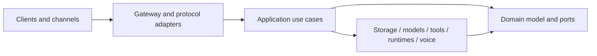

# JARVIS Architecture

**One trusted core. Many replaceable capabilities.**

[Home](README.md) / [Documentation](docs/README.md) / [Roadmap](ROADMAP.md) / [Decisions](docs/adr/README.md)

The canonical design is split by ownership boundary. This is your map of those boundaries, not a duplicate specification.

> **Design is not delivery.** These specifications include target profiles and adapters that are not shipped. Start with the [current capability summary](README.md#built-experimental-next) and [backlog](TODO.md) for implementation and live-verification status. Later accepted ADRs supersede earlier design choices.

## System Shape

JARVIS uses a daemon/client topology. `jarvisd` is the only process allowed to coordinate canonical identity, policy, approvals, memory, workflow state, and audit history. User interfaces and external agents are authenticated clients.

The dependency rule is inward: applications and adapters depend on domain interfaces; the domain never imports Axum, SQLx, provider SDKs, Tauri, OpenClaw, LangGraph, or ElevenLabs.

## Canonical Specifications

| Boundary | Canonical reference | Key question |
| --- | --- | --- |
| System | [Overview](docs/architecture/overview.md) / [repository layout](docs/architecture/repository-layout.md) | Which process and crate own the decision? |
| Reasoning | [Runtimes and models](docs/architecture/runtime-and-models.md) | Can the model or runtime be replaced without losing authority? |
| Effects | [Tools, MCP and connectors](docs/architecture/tools-and-connectors.md) | Who authorizes and records an action? |
| Memory | [Memory and context](docs/architecture/memory-and-context.md) | Where did this fact come from, and can it be forgotten? |
| Identity | [Identity and workspaces](docs/architecture/identity-and-workspaces.md) | Which actor has access to which resource? |
| Durability | [Storage](docs/architecture/storage.md) / [data schema](docs/data/schema.md) | What survives a restart? |
| Automation | [Events and workflows](docs/architecture/events-and-workflows.md) | Can work resume without duplicating an effect? |
| Voice | [Voice and telephony](docs/architecture/voice-and-telephony.md) | Which session and authority does a voice represent? |
| Security | [Threat model](docs/architecture/security.md) | What happens when input is hostile or evidence is missing? |
| Interoperability | [Protocols](docs/architecture/protocols.md) / [contracts](docs/api/contracts.md) | What may cross a public or adapter boundary? |

## Integration Research

Records for external contracts and the platform primitives JARVIS depends on live
in [docs/research/integrations](docs/research/integrations/README.md). Each record
states the exact versions, limits, and unresolved ambiguities that implementation
must satisfy; the index lists current status per integration.

## Decisions

Accepted decisions live in [docs/adr](docs/adr/README.md). A change requires a new or superseding ADR when it alters process topology, trust boundaries, canonical data ownership, public protocol semantics, storage guarantees, or extension isolation.

## Delivery

- [Roadmap](ROADMAP.md)
- [Backlog](TODO.md)
- [Acceptance scenarios](docs/quality/acceptance-tests.md)
- [Testing strategy](docs/development/testing.md)
- [Definition of done](docs/development/definition-of-done.md)
- [Install and release plan](docs/operations/install-and-release.md)
- [Observability and diagnostics](docs/operations/observability.md)
- [Prototype migration](docs/migration/python-prototype.md)