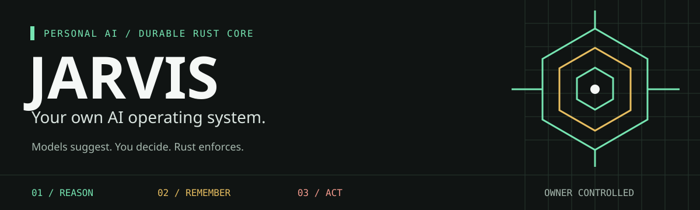
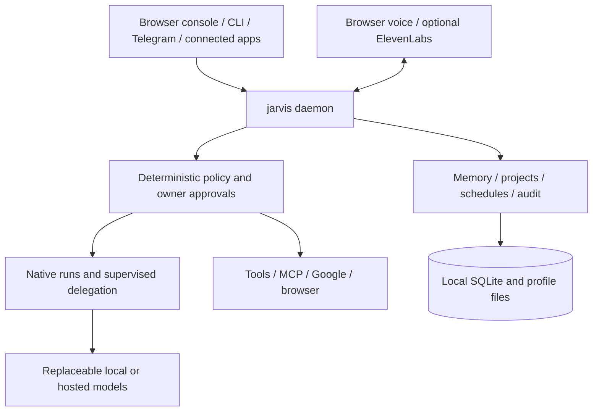

<h1 align="center">JARVIS</h1>
<p align="center"></p>
<p align="center"><strong>Your own AI operating system.</strong><br>Persistent memory. Real tools. A voice. You remain in control.</p>

<p align="center">
    <a href="https://github.com/props-nothing/jarvis-core/actions/workflows/ci.yml"></a>
    <a href="docs/architecture/overview.md"></a>
    <a href="docs/user/quick-start.md"></a>
    <a href="docs/user/platforms.md"></a>
</p>

<p align="center">
    <a href="#quick-start">Quick start</a> &middot;
    <a href="docs/README.md">Documentation</a> &middot;
    <a href="ROADMAP.md">Roadmap</a> &middot;
    <a href="CONTRIBUTING.md">Contributing</a> &middot;
    <a href="SECURITY.md">Security</a> &middot;
    <a href="LICENSE">Apache-2.0</a>
</p>

JARVIS is a **local-first personal AI assistant with a durable Rust core**. Talk to it, give it a project, connect your tools, and watch it work. Your conversations, memory, approvals and task state stay with JARVIS, not with a replaceable model or agent framework.

Use a local or hosted OpenAI-compatible model, choose a fallback, and reach the same assistant from the browser console, terminal, Telegram or an authenticated external app. Cloud models and connected services receive the data needed for the operations you enable; local-first does not mean every integration is offline.

> **Models suggest. You decide. Rust enforces.**
> JARVIS run tool effects pass through deterministic policy, durable approvals and an audit trail. Direct external MCP calls use policy and owner approval, but their pending approvals are in memory and their direct outcomes are not yet stored in run history. A web page cannot grant permissions, and a model cannot approve its own request.

## What You Can Do

| Capability | What JARVIS does today |
| --- | --- |
| **Talk and watch** | A browser console with a reactive face, text and voice, live activity, sources, approvals and a stop control. Browser speech recognition; optional ElevenLabs synthesis. |
| **Work with your files** | Read, search, write, edit and move within granted folders; recoverable single-file trash. Read PDF, Word, spreadsheets and slides; create documents and edit literal XLSX cells; optional Tesseract OCR. |
| **Use the web** | Fetch pages and PDFs, use a built-in browser, look up developer documentation, and search with a configured search key. |
| **Connect your day** | Google sign-in for Gmail and Calendar: mail, drafts, replies, attachments and events, with policy-controlled effects. |
| **Keep a project moving** | Project goals, guidance, journals, recurring schedules, mail/file/webhook triggers, quiet hours, digests and run/token budgets. |
| **Remember deliberately** | Proposed memories and procedures that the owner approves, with inspectable state rather than a provider-owned chat history. |
| **Extend its reach** | Managed MCP servers and an opt-in app endpoint; Telegram for phone access. Additional services through existing protocols first. |
| **Delegate coding** | Queued work in your permitted folder, full skill bundles, independent checks and managed previews. Git/worktrees are opt-in; approved agents run as host processes. |
| **Stay accountable** | Durable approvals, cancellation, audit records, model usage and evaluation suites. Sub-agents and background work use the same authority boundary. |

See [the user guide](docs/user/quick-start.md), [abilities](docs/user/abilities.md) and [settings](docs/user/settings.md) for setup, defaults and limits.

## Quick Start

**Source setup today:** install the pinned Rust toolchain and the native build prerequisites in the [development guide](docs/development/getting-started.md). Have a local model server such as [Ollama](https://ollama.com), or a hosted OpenAI-compatible provider ready.

```text
git clone https://github.com/props-nothing/jarvis-core.git
cd jarvis-core
cargo build --release -p jarvis-cli
```

Windows:

```powershell
.\target\release\jarvis.exe
```

macOS / Linux:

```bash
./target/release/jarvis
```

For a new setup, the first run guides provider/model selection, requires a working **ElevenLabs text-to-speech API key**, and offers optional folder grants. Interactive secret entry is hidden; model access and speech synthesis must pass tests before configuration is saved. The speech test sends a short sentence to ElevenLabs and may use credits. Setup then starts the assistant and opens its signed-in browser console. Existing configurations are not re-prompted; later runs reopen the console. Use `jarvis install` to install the built program for your user; `jarvis hud` reopens the console.

> **Release status:** JARVIS is open source under [Apache-2.0](LICENSE). CI produces unsigned platform artifacts; published releases still need dependency notices, signing/notarization and clean-machine verification. The separate product website offers source-building bootstrap scripts, not signed prebuilt releases; they require a development toolchain. [Platform notes](docs/user/platforms.md) distinguish tested behavior from targets.

## Built, Experimental, Next

**Working assistant:** browser and CLI, Google tools, Telegram, MCP management, approved skills, time-zone schedules and triggers, project journals, model routing and spend guards. The [backlog](TODO.md) records the acceptance evidence and remaining live checks.

**Limited first slices:** outbound calls to listed owner numbers through an ElevenLabs agent have been run live by the owner. ACP coding has recorded ordinary/background Codex tasks and a dependency-install/check smoke; real-account console sign-in, real-agent cancellation and complete desktop/mobile website acceptance remain open. Jobs default to in-place work without automatic commits or an imposed total deadline. Independent checks report their own outcome; an agent's completion alone is not delivery proof, and host execution is **not a sandbox**. See [coding agents](docs/user/code-agents.md) and [the roadmap](ROADMAP.md).

**Not shipped:** a Tauri desktop client, browser-independent local voice, general telephony, signed public installers and the complete server/multi-device profile. The multi-step durable workflow engine is parked until a named requirement needs more than ordinary runs and schedules.

## How It Fits Together

One native program, one trusted core, replaceable models and tools. The CLI runs the daemon as `jarvis daemon`; the daemon owns durable state and authorization. The diagram below shows the current local-first path, not a claim that every planned adapter has shipped.



## Non-Negotiable Boundaries

- Rust is the durable control plane.
- `jarvisd` owns identity, sessions, policy, approvals, tools, memory, workflow state, events, secrets, APIs, and audit records.
- Models suggest. Deterministic policy authorizes.
- Agent frameworks are replaceable runtimes, normally isolated out of process.
- MCP is an interoperability boundary, not JARVIS's internal domain model.
- Voice is an interface, not a separate brain or source of truth.
- SQLite is the zero-dependency local default; PostgreSQL plus pgvector is the server and multi-device backend.
- External API work starts with current official documentation or an official `llms.txt` index and leaves a dated research record.

## Find Your Way

| Goal | Start here |
| --- | --- |
| Start your assistant | [Quick start](docs/user/quick-start.md) / [platforms](docs/user/platforms.md) |
| Choose models, voice and permissions | [Settings](docs/user/settings.md) |
| Add tools or connect another app | [Abilities](docs/user/abilities.md) / [connect apps](docs/user/connect-apps.md) |
| Keep long-running work organized | [Projects](docs/user/projects.md) / [evaluations](docs/user/evals.md) |
| Understand the trust boundary | [Architecture](ARCHITECTURE.md) / [security](docs/architecture/security.md) |
| Build or contribute | [Contributing](CONTRIBUTING.md) / [engineering rules](AGENTS.md) |
| See what is next | [Roadmap](ROADMAP.md) / [acceptance backlog](TODO.md) |
| Browse the complete reference | [Documentation](docs/README.md) / [ADRs](docs/adr/README.md) |

## Current Workspace

```text
jarvis-core/
|-- Cargo.toml            Rust workspace and lint policy
|-- rust-toolchain.toml   Pinned compiler, Clippy, and rustfmt
|-- AGENTS.md              Repository-wide AI engineering rules
|-- README.md              Product entry point
|-- ARCHITECTURE.md        Architecture document index
|-- ROADMAP.md             Ordered release phases and gates
|-- TODO.md                Executable implementation backlog
|-- apps/                  Daemon and CLI composition roots
|-- crates/                Domain, application, protocol, and storage crates
|-- frontend/              Product website, separate from the daemon console
`-- docs/                  Canonical specifications, migration records, and ADRs
```

The target source tree is specified in [repository-layout.md](docs/architecture/repository-layout.md). It is created incrementally in the order defined by [TODO.md](TODO.md); absent crates and directories are not implied implementations.

## Prototype Notice

The former Python prototype is no longer part of the current tree. Its [migration record](docs/migration/python-prototype.md) retains the behavior and license boundaries: it identified itself as CC BY-NC 4.0 and used patterns unsuitable for the production trust boundary, including plaintext credential storage and in-process tool execution. Historical source is not permission to reuse it. Preserve useful behavior through documented acceptance tests and clean-room implementations unless license compatibility is explicitly established.

## License Status

Original JARVIS code and documentation are open source under the [Apache License 2.0](LICENSE), selected on 2026-10-14. It permits use, modification and redistribution, including commercial use, with attribution and an explicit contributor patent grant. Preserve the license and applicable [NOTICE](NOTICE) when redistributing.

Third-party dependencies and the MediaPipe face geometry retain their own terms; see [THIRD_PARTY.md](THIRD_PARTY.md). The separately maintained [website repository](https://github.com/props-nothing/jarvis-frontend) uses the same license for its original code. The removed CC BY-NC 4.0 Python prototype and historical copies are **not** relicensed. License selection does not mean signed downloads or release-verification gates are complete.
